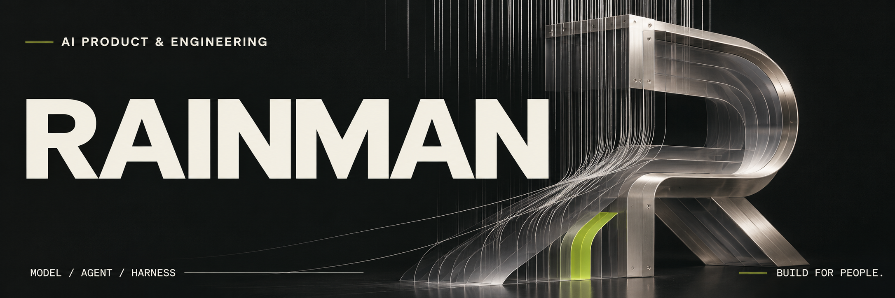
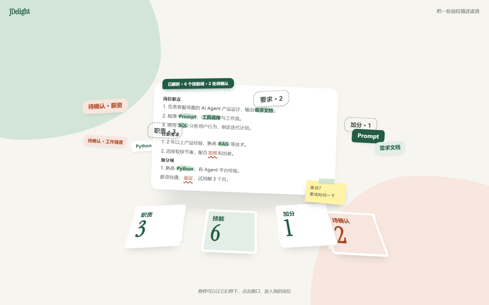

**我做 AI 工具，也关心它们如何被使用。**

我是 Rainman。从具体问题出发，连接产品判断、界面设计与工程实现。这里收录我的独立产品、AI 协作实践，以及维护的中文创作资源。

## 产品工具

<table width="100%">
<tbody>
<tr>
<td width="50%" valign="top">

产品界面 · 示例数据

<h3>JDelight</h3>

<strong>读懂一份 JD，带着依据准备面试。</strong>

面向在校求职者，将岗位描述整理为七章分析报告，关联原文出处并区分依据与推断。支持选中追问、报告版本管理和面试前速览，数据采用本地优先存储。

</td>
<td width="50%" valign="top">

Windows 桌面应用 · 文稿工作区

<h3>听记 · Tingji</h3>

<strong>把音视频变成能搜索、回听和校对的逐字稿。</strong>

支持中英文转写、说话人分组、长文件中断续转，以及 TXT、SRT、Markdown、JSON 导出。模型在本机运行，推理不上传音视频或文稿，无需 API Key。

</td>
</tr>
<tr>
<td width="50%" valign="top">

Next.js · React · TypeScript · IndexedDB

本地完整流程已完成，真实模型分析仍在验证。

<a href="https://www.jdelight.top"><strong>访问网站 →</strong></a> · <a href="https://github.com/rainman016/JDelight#readme">源码与说明</a>

</td>
<td width="50%" valign="top">

Python · 本地语音模型 · Windows

目前提供源码安装，首次使用需联网下载模型。

<a href="https://github.com/rainman016/tingji#readme"><strong>查看项目与安装说明 →</strong></a>

</td>
</tr>
</tbody>
</table>

## AI 协作

把实际协作中遇到的问题，整理成可以复用的规则与模板：手册关注多个 AI 会话如何配合，脚手架关注一个代码项目如何交接与交付。

<table width="100%">
<tbody>
<tr>
<td width="50%" valign="top">
<h3>一人 AI 团队协作手册</h3>

<strong>多个 AI 窗口，清楚分工，接得上进度。</strong>

围绕任务分工、状态记录、验收证据和操作授权，整理一个人协同多个 AI 会话的工作方式。提供 Markdown 岗位卡与任务模板，适用于 Claude Code、Codex 等工具。

</td>
<td width="50%" valign="top">
<h3>AI 协同开发脚手架</h3>

<strong>让代码项目有交接记录，也有交付标准。</strong>

为新项目或已有仓库建立交接记录、代码交付规则与文档上限检查。提供搭建指令、模板和检查脚本，让新会话能接续工作；可独立使用，也可配合协作手册。

</td>
</tr>
<tr>
<td width="50%" valign="top">

协作方法 · Markdown 岗位卡 · 交接模板

<a href="https://github.com/rainman016/solo-ai-team-playbook#readme"><strong>阅读协作手册 →</strong></a>

</td>
<td width="50%" valign="top">

项目规范 · 交付检查 · 文档管理

<a href="https://github.com/rainman016/ai-collab-dev-scaffold#readme"><strong>查看搭建指引 →</strong></a>

</td>
</tr>
</tbody>
</table>

## 创作资源

<table width="100%">
<tbody>
<tr>
<td width="50%" valign="top">

效果库页面 · 实际截图

</td>
<td width="50%" valign="top">
<h3>Motion Prompt 中文版</h3>

<strong>让视觉需求说得清楚，也能交给 AI。</strong>

Motion Prompt 的非官方中文本地化与扩展，提供 144 项动效和视觉效果的中文说明、规格与 Prompt。支持搜索、动态预览和多选，并通过 Codex Skill 将选定效果与补充说明回传本地 CLI。

JavaScript · Node.js · Codex Skill

<a href="https://rainman016.github.io/motion-prompt-zh/"><strong>浏览动效库 →</strong></a> · <a href="https://github.com/rainman016/motion-prompt-zh">源码</a>

</td>
</tr>
</tbody>
</table>

Motion Prompt 中文版基于 <a href="https://github.com/showheyohtaki/motion-prompt">Shohei Ohtaki 的 Motion Prompt</a>。本版贡献为中文翻译、本地化与相关扩展，原作者的代码、动画及素材归属保持不变。

