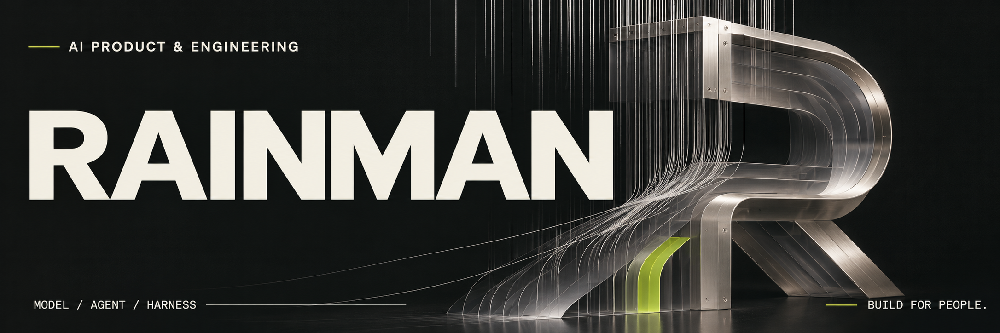

**我做 AI 工具，也关心它们如何被使用。**

我是 Rainman。这里有我做过的工具、维护的中文资源，以及持续研究的问题。当前实践围绕岗位分析和 AI 辅助创作，关注模型能力、Agent 工作流与 Harness 运行机制。

[看 JDelight](https://github.com/rainman016/JDelight) · [体验中文动效库](https://rainman016.github.io/motion-prompt-zh/)

---

## 01 / JDelight
### 读懂一份 JD，也能核实每一个判断。

校招岗位描述往往很短，要求却不容易判断。JDelight 面向在校求职者，将 JD 整理为结构化岗位分析报告，帮助理解要求、追问疑点，并在面试前快速回看。

我在这个项目中重点关注三个问题：

- **结论为什么可信？** 分析关联原文出处，区分原文依据与推断，并通过结构与引用校验约束输出。
- **追问之后留下什么？** 将有用的解答补充进报告，以新版本保留，方便继续修改与回看。
- **准备面试时怎么用？** 用速览汇总准备重点，支持复制与导出；原文和报告采用本地优先存储。

**实现基础**：Next.js / React / TypeScript / IndexedDB / Zod / Vitest / Playwright

**进展**：本地完整流程已完成，真实模型分析与邀请码试用仍在验证。

[查看项目、界面与实现](https://github.com/rainman016/JDelight#readme)

---

## 02 / Motion Prompt 中文版
### 让视觉需求说得清楚，也能交给 AI。

我维护 Motion Prompt 的非官方简体中文版本，围绕中文理解、效果选择与 AI 工具使用补充本地化体验。

- **理解效果**：144 项效果资料提供中文名称、解释、规格与适用场景。
- **表达意图**：通过搜索、动态预览和多选，整理视觉参考与 Prompt。
- **衔接工具**：提供中文 Skill，支持网页选择、补充说明与向本地 CLI 回传。

**实现基础**：HTML / CSS / JavaScript / Node.js / GitHub Pages / Skill 与 CLI

**进展**：已提供在线版本。

[打开效果库](https://rainman016.github.io/motion-prompt-zh/) · [查看源码](https://github.com/rainman016/motion-prompt-zh)

基于 Shohei Ohtaki 的 Motion Prompt。本版贡献为中文翻译、本地化与相关扩展，保留原作者的代码、动画及素材归属。

---

## 持续研究的问题

**Model / 模型能力**  
模型适合承担什么任务？怎样用具体场景评价效果，并权衡能力、成本与时延？

**Agent / 任务与协作**  
任务中哪些步骤需要自主判断？上下文、记忆、工具和人工介入怎样配合，才能推进工作？

**Harness / 运行与控制**  
如何管理执行边界、任务状态和预算？长任务如何留下可检查的记录，又能在中断后恢复？

评测贯穿这些探索：定义成功标准、记录失败案例，再验证每次调整是否真正改善了结果。

## 希望参与的工作

关注 **AI 全栈开发 · FDE · AI 产品经理 · UX/UI 工程师**相关机会。

希望参与需要同时考虑产品判断、系统实现和人机体验的项目，包括 AI 应用开发、Agent 工作流设计，以及真实业务环境中的系统接入、上线验收与持续迭代。
