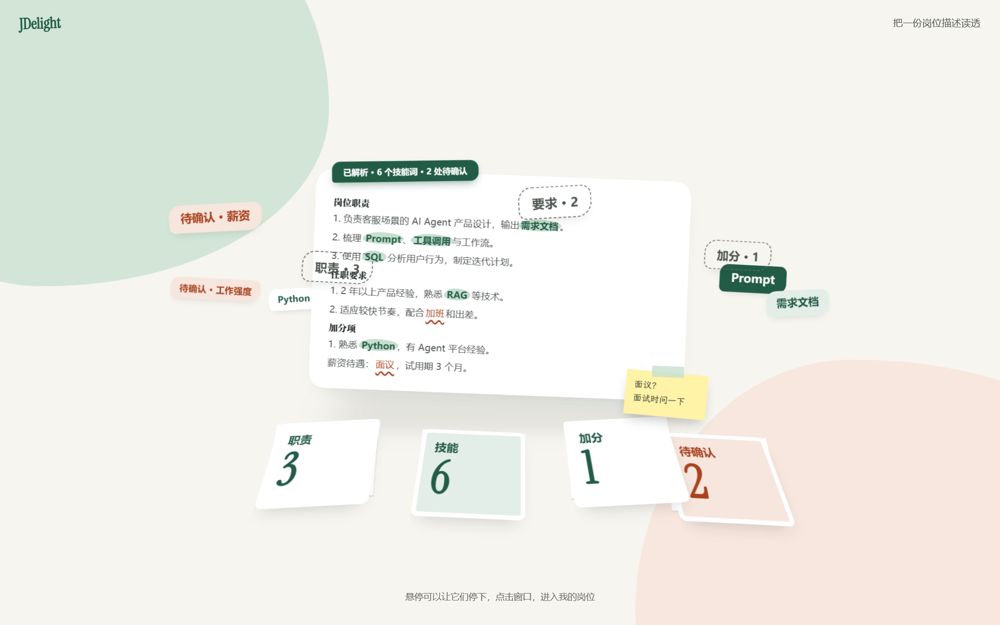
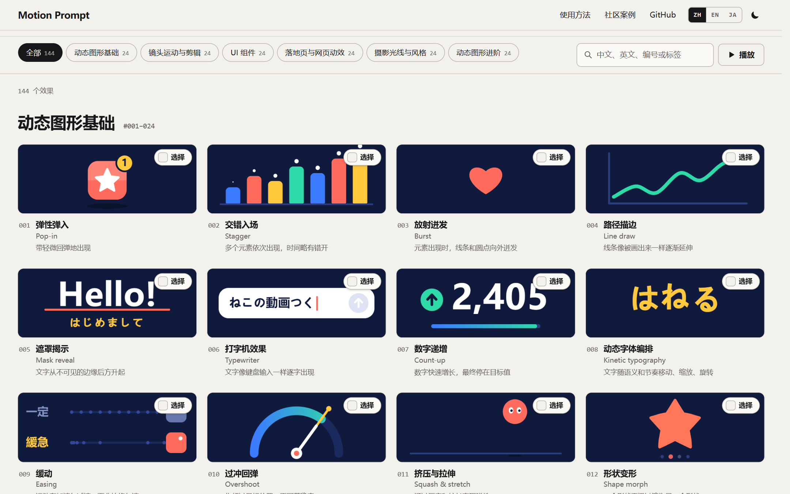

**我做 AI 工具，也关心它们如何被使用。**

我是 Rainman。从具体问题出发，连接产品判断、界面设计与工程实现。这里展示我的独立产品实践，以及参与维护的中文开源资源。

## 项目简介

<table width="100%">
<tbody>
<tr>
<td width="50%" valign="top">

产品界面 · 示例数据

<h3>01 / JDelight</h3>

面向在校求职者的 JD 分析工具，将岗位描述整理为七章结构化报告，并为分析结论关联原文出处。支持选中追问、报告版本管理与面试前速览，数据采用本地优先存储。

</td>
<td width="50%" valign="top">

效果库页面 · 实际截图

<h3>02 / Motion Prompt 中文版</h3>

Motion Prompt 的非官方中文本地化与扩展，提供 144 项动效和视觉效果的中文说明、规格与 Prompt。支持搜索、动态预览、多选，并通过 Codex Skill 将选定效果与补充说明回传本地 CLI。

</td>
</tr>
<tr>
<td width="50%" valign="top">

Next.js · TypeScript · IndexedDB

<a href="https://github.com/rainman016/JDelight#readme"><strong>查看项目与界面 →</strong></a>

</td>
<td width="50%" valign="top">

JavaScript · Node.js · Codex Skill

<a href="https://rainman016.github.io/motion-prompt-zh/"><strong>浏览动效库 →</strong></a> · <a href="https://github.com/rainman016/motion-prompt-zh">源码</a>

</td>
</tr>
</tbody>
</table>

Motion Prompt 中文版为非官方中文本地化与扩展，基于 <a href="https://github.com/showheyohtaki/motion-prompt">Shohei Ohtaki 的 Motion Prompt</a>；原作者的代码、动画及素材归属保持不变。
